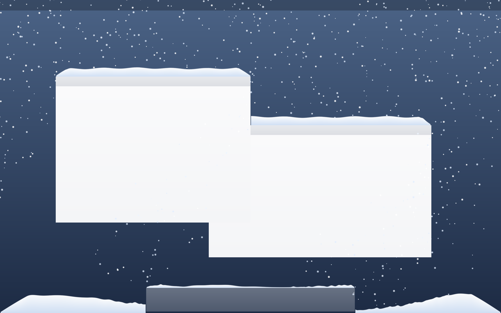
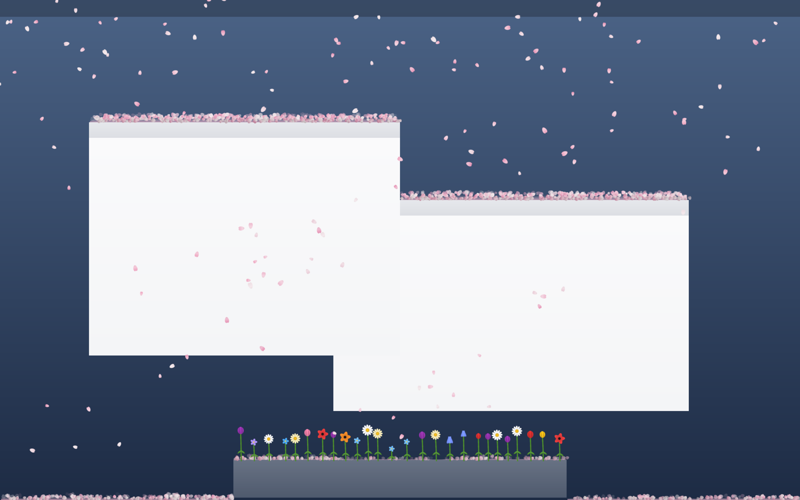

# Seasons

Snow, autumn leaves, rain and cherry blossoms falling over your Mac desktop. They pile up on the Dock, on window tops and at the bottom of the screen, and you can sweep them away with the mouse pointer. In spring, flowers grow along the top of the Dock.

<!-- Screenshot placeholder: replace these renders with a real screenshot or a short GIF. -->
| Snow | Cherry blossoms and flowers |
|---|---|
|  |  |

*Placeholder images: offscreen renders on a synthetic desktop (`Seasons --render-preview`), not real screenshots.*

## Features

- **Five effects:** snow (winter), autumn leaves, rain, cherry blossoms (spring) and flowers along the Dock. The flowers can be combined with any effect.
- **Things pile up** on the screen bottom, on top of the Dock and on the visible top edges of windows. Piles spread out naturally and never grow beyond a maximum height (snow: 30 pt on the screen bottom, 24 pt on the Dock, 20 pt on windows).
- **Sweep with the pointer:** the pointer pushes falling particles away, digs into piles and throws the material up so it falls again. No clicks are intercepted.
- **Windows matter:** move a window quickly and its snow slides off. Close or minimize it and the pile falls down. Covered parts of an edge collect nothing. Piles survive switching Spaces.
- **Flowers** grow slowly, sway in the wind, bend away from the pointer and can be swept off with a fast move. They grow back.
- **Automatic by season:** snow in winter, blossoms and flowers in spring, nothing (or optionally rain) in summer, leaves in autumn (northern hemisphere).
- **Light on resources:** pauses when the screen is locked, asleep, showing the screen saver or covered, and when nothing moves. Runs at 30 fps on battery and 20 fps in Low Power Mode.
- **Menu bar only:** no Dock icon. English and German, following the system language.
- **Procedural graphics:** everything is drawn by shaders. No image assets.

## Installation

### Homebrew

```sh
brew install --cask LaJuMiRa/tap/seasons   # placeholder until the tap exists
```

### Manual

1. Download `Seasons-<version>-arm64.zip` from the [Releases](../../releases) page and unzip it.
2. Move `Seasons.app` to `/Applications`.
3. Start it. A snowflake appears in the menu bar.

### First start: Gatekeeper warning

- **macOS 15 Sequoia and newer:** try to open the app once, then go to **System Settings › Privacy & Security**, scroll down and click **Open Anyway** next to the Seasons message, and confirm.
- **macOS 14 Sonoma:** right-click (or Control-click) `Seasons.app` in Finder, choose **Open**, then confirm **Open** in the dialog.
- **Terminal alternative (any version):** `xattr -dr com.apple.quarantine /Applications/Seasons.app`

You only need to do this once.

**Requirements:** macOS 14 Sonoma or newer, Apple Silicon (M1 or later).

## Permissions and privacy

- **No permission is needed.** Seasons reads only the position and size of on-screen windows via `CGWindowListCopyWindowInfo`. On macOS 27.0.1 returns window bounds, layer and owner. It withholds only window titles, and Seasons never reads titles anyway.
- **If macOS restricts the window list** (for example in a future version), Seasons keeps working with the Dock and the screen bottom only. The menu then shows "Window detection unavailable" and a button that opens **Privacy & Security › Screen Recording**, where you can allow Seasons.
- Seasons also reads the local Dock preferences (`com.apple.dock`: position, auto-hide, icon size, number of items) to estimate the Dock's width.
- **No network access, no telemetry, no data collection.** Settings are stored locally in `~/Library/Preferences/com.laurenzrauscher.Seasons.plist`. See [PRIVACY.md](PRIVACY.md).

## Usage

Click the menu bar icon:

| Menu item | What it does |
|---|---|
| Snow / Autumn Leaves / Rain / Cherry Blossoms | Choose the falling effect (turns automatic mode off) |
| Flowers on the Dock | Let flowers grow along the Dock (combinable) |
| Choose Automatically by Season | Pick the effect from the date; shows the current season |
| Rain in Summer | In automatic mode, let it rain in summer instead of showing nothing |
| Pause / Resume (⌘P) | Freeze everything |
| Amount | Off, Light, Medium, Heavy or Variable (changes slowly over time) |
| Clear Now (⌘K) | Remove everything immediately |
| Melt Away | Switch: while checked, piles melt within seconds and nothing stays; uncheck to let things pile up again |
| Pile Up on Windows and Dock | Off: only the screen bottom collects |
| Hide in Screenshots and Screen Sharing | Keeps the overlay out of captures (on by default, see limitations) |
| Launch at Login | Start Seasons when you log in |
| About Seasons / Quit Seasons (⌘Q) | |

All settings are remembered.

## Building from source

Requirements: macOS 14+, Apple Silicon and the Xcode Command Line Tools (`xcode-select --install`). The Xcode app itself is not needed: the Metal shaders are compiled at runtime.

```sh
swift build          # debug build
swift test           # unit tests (simulation core and menu)
./build.sh           # release app bundle in build/Seasons.app (ad-hoc signed)
./release.sh         # build plus dist/Seasons-<version>-arm64.zip and SHA-256
```

If the repository lives in a folder synced by **iCloud Drive**, `swift test` fails at the code-signing step because iCloud adds Finder metadata. Use a build folder outside iCloud:
`swift test --scratch-path /tmp/seasons-spm`. `build.sh` already does this.

Developer aid: `Seasons --render-preview <folder>` writes PNG previews of every effect on a synthetic desktop, rendered with the real Metal pipeline.

Architecture, decisions and measurements: [docs/ARCHITECTURE.md](docs/ARCHITECTURE.md). Releasing: [RELEASING.md](RELEASING.md).

## Roadmap

- **Windows:** port the overlay and window detection (layered window plus DirectX or OpenGL); reuse `SeasonsCore` unchanged.
- **Linux:** an X11/Wayland overlay where the compositor allows click-through windows; reuse `SeasonsCore`.
- Snow falling across connected displays.
- Optional southern-hemisphere seasons.

## Acknowledgements

Inspired by:
- [snowfall](https://github.com/barredewe/snowfall) by **barredewe** (Apache-2.0),
- [Snowhush](https://github.com/mbezruchko/Snowhush) by **mbezruchko** (MIT).

**No code was copied from these projects.** Seasons was written from scratch.

## License

[MIT](LICENSE) © 2026 Laurenz Rauscher
